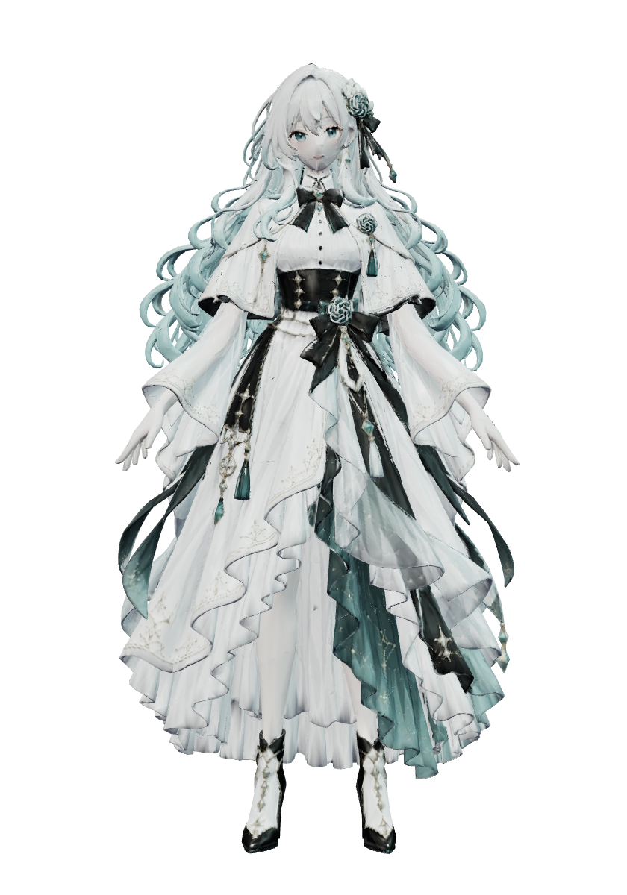

# GPT 娘 3D 桌宠

一个运行在 Windows 桌面上的 3D 角色，使用 Electron 和 Three.js 渲染。角色由 Meshy 模型制作，在 Blender 中完成骨骼绑定和动画，支持拖动、切换动作、滚轮旋转和缩放。

<p align="center">
  
</p>

安装依赖并下载模型后，桌宠可以离线运行，无需同时打开 Blender 或 Meshy。目前提供独立桌面角色与动画交互，尚未接入 Codex 工作状态、聊天或语音接口。

## 功能

- 透明背景、无边框、桌面置顶，支持拖动位置、隐藏、托盘菜单和鼠标穿透。
- 8 个骨骼动画：待机、挥手、点头、鞠躬、开心、原地踏步、看看四周和打瞌睡。
- 动作结束后回到待机，可通过菜单开启或关闭随机小动作。
- 鼠标滚轮平滑旋转，360° 查看模型；支持缩放和一键恢复正面。
- V2 实时模型包含 35 根骨骼、350,479 个三角面；Blender 工程同时保留完整高模和实时版本。

## 快速运行

当前通过源码启动，桌面交互已在 Windows 上验证。准备好 Git、Git LFS、Node.js 和 npm，然后在 PowerShell 中执行：

```powershell
git lfs install
git clone https://github.com/cyberiat/codex-girl-3d.git
cd codex-girl-3d
git lfs pull
npm ci
npm run build
npm start
```

模型和 Blender 工程由 Git LFS 管理，完整资源约 896 MB，另需下载 npm 依赖。建议使用上述克隆方式；直接下载仓库 ZIP 可能只得到模型的 LFS 指针文件。

桌宠启动后会出现在主屏幕右下角。后续在项目目录运行 `npm start` 即可；修改渲染代码后需要重新构建并重启。运行桌宠不需要安装 Blender，编辑模型时才需要。

## 操作

| 操作 | 效果 |
| --- | --- |
| 左键拖动角色 | 移动桌宠窗口 |
| 单击角色 | 播放挥手动作 |
| 鼠标滚轮 | 平滑旋转模型 |
| Ctrl + 鼠标滚轮 | 缩放模型 |
| Shift + 左键横向拖动 | 旋转模型 |
| 右键 | 打开动作、转向、大小及桌宠设置菜单 |
| 右键 → 恢复正面 | 转回正面 |
| Ctrl + Alt + G | 显示桌宠并关闭鼠标穿透 |
| 双击托盘图标 | 显示桌宠并关闭鼠标穿透 |
| 右键菜单 → 退出桌宠 | 退出程序 |

启用鼠标穿透后，鼠标可以操作桌宠下方的窗口；使用 `Ctrl + Alt + G` 恢复交互。隐藏桌宠后，也可以通过托盘图标找回。

## 动作

| 动画名称 | 菜单名称 |
| --- | --- |
| `Idle` | 待机 |
| `Wave` | 挥手 |
| `Nod` | 点头 |
| `Bow` | 鞠躬 |
| `Happy` | 开心 |
| `Walk` | 原地踏步 |
| `LookAround` | 看看四周 |
| `Sleep` | 打瞌睡 |

V2 动作加入了预备、停顿和回弹，以及发梢、袖口和裙摆的跟随运动。各动作的应用内截图见 [verification](verification/)。

## 项目结构

```text
app/
  main.cjs                         Electron 窗口、托盘、菜单及模型读取
  preload.cjs                      主进程与渲染进程通信
  renderer.js                      Three.js 场景、动画与鼠标交互
  index.html                       透明窗口界面
assets/
  gpt-girl-animated-v2.glb          当前桌宠使用的动画模型
  gpt-girl-animated.glb             保留的 V1 动画模型
  character-reference.png          角色设计参考
  gpt-girl-a-pose.png               建模参考及托盘图标来源
blender/
  GPT-Girl-Desktop-Pet-V2.blend     V2 可编辑工程
  GPT-Girl-Desktop-Pet.blend        保留的 V1 工程
  mcp-*.py                        V2 的 Blender 场景编辑脚本
tools/blender-mcp/                 MCP 客户端、请求记录与工具说明
verification/                     动作截图与验证报告
使用说明.txt                       本机使用及制作说明
```

`assets/` 中还保留了 Meshy 原始模型。`node_modules/`、构建产物 `app/bundle.js`、运行日志、本机快捷方式及 Blender 自动备份不纳入版本管理。

## 编辑模型和动画

V2 工程使用 Blender 5.1.2 制作，文件为 [GPT-Girl-Desktop-Pet-V2.blend](blender/GPT-Girl-Desktop-Pet-V2.blend)。其中主要对象为：

| 对象 | 用途 |
| --- | --- |
| `GPT_Girl_Rig` | 35 根骨骼组成的角色骨架 |
| `GPT_Girl_Desktop_V2` | 默认显示的实时模型，约 35 万三角面 |
| `GPT_Girl_HighRes_Master` | 完整高模，约 779 万三角面，已绑定同一套动作 |

完整高模默认关闭视口显示，以减少编辑时的计算量。查看高模时，先隐藏实时模型，再在 Outliner 的过滤器中启用“禁用视图”列，打开高模的显示器图标及眼睛图标。

V2 通过 Blender MCP 在 Blender 场景内完成编辑，再由 Blender 的 glTF 导出器导出。`blender/mcp-*.py` 和 `tools/blender-mcp/` 保留了制作过程；这些脚本与请求包含制作机器上的绝对路径，复用前需要调整路径并检查场景对象名称。MCP 插件和连接需要在编辑机器上单独配置。

桌宠从 `assets/gpt-girl-animated-v2.glb` 加载模型。重新导出时保留“动作”一节中的 8 个动画名称，替换该文件后重启桌宠即可。`blender/build_pet.py` 属于 V1 历史流程，继续编辑以 V2 工程为准。

## 开发与验证

项目使用 Electron、Three.js 和 esbuild，具体依赖版本见 [package.json](package.json)，安装版本由 `package-lock.json` 锁定。

```powershell
# 构建渲染脚本
npm run build

# 启动桌宠
npm start
```

验证动画时，先通过右键菜单退出正在运行的桌宠，再执行：

```powershell
npm start -- --verify
```

验证模式会在实际渲染器中采样 8 个动作，记录骨骼和蒙皮变换的数值检查、模型面数及透明背景状态，并保存各动作截图，完成后自动退出。结果写入 `verification/report.json`，截图写入同一目录。

仓库中的 [验证报告](verification/report.json) 记录了 V2 的 8 个动作通过检查、35 根骨骼及 350,479 个三角面。这些数值检查不能替代对穿模和动作观感的人工检查。

## 常见问题

**启动后窗口空白或提示模型加载失败**

确认运行过 `npm run build`，并通过 `git lfs pull` 下载了完整模型。可以运行 `git lfs fsck` 检查 LFS 文件完整性；当前动画 GLB 约 30 MB，只有几行文本的文件是 LFS 指针。

**角色无法拖动或点击**

可能已启用鼠标穿透。按 `Ctrl + Alt + G`，或双击托盘图标恢复。

**验证模式没有开始，只显示了原来的桌宠**

程序限制为单实例。先退出已有桌宠，再运行验证命令。

## 当前模型限制

长发、袖子和长裙来自连体生成网格，使用骨骼权重近似变形，大幅动作仍可能出现穿模或拉伸，没有实时布料模拟。模型没有独立眼皮和口型，打瞌睡使用低头姿势；行走动作是原地踏步。
